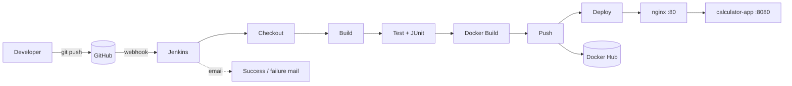

# Calculator API — CSE 816 SPE Mini-Project

A small Spring Boot REST API that performs basic arithmetic, shipped through an
end-to-end CI/CD pipeline built with **Git/GitHub, Jenkins, Docker and Docker Compose**.

Every push to `main` on GitHub triggers Jenkins, which builds and tests the code,
builds a Docker image, pushes it to Docker Hub and redeploys the stack
(Spring Boot app behind an Nginx reverse proxy) with Docker Compose.

## Tech stack

| Concern            | Tool                                   |
|--------------------|----------------------------------------|
| Language / runtime | Java 21                                |
| Framework          | Spring Boot 4 (Web MVC + Actuator)     |
| Build / tests      | Maven, JUnit 5, Spring MockMvc         |
| Source control     | Git + GitHub                           |
| CI/CD              | Jenkins (declarative `Jenkinsfile`)    |
| Containers         | Docker (multi-stage build), Docker Hub |
| Deployment         | Docker Compose (app + Nginx)           |

## Prerequisites

- JDK 21 (`java -version`)
- Maven 3.9+ (`mvn -v`) — or use the bundled wrapper `./mvnw` / `mvnw.cmd`
- Docker Desktop / Docker Engine with the Compose v2 plugin (`docker compose version`)
- For the pipeline: a Jenkins instance and a Docker Hub account

## Build

```bash
mvn clean package
```

Produces `target/calculator-0.0.1-SNAPSHOT.jar` (tests run as part of `package`;
add `-DskipTests` to skip them).

## Test

```bash
mvn test
```

- `CalculatorServiceTest` — unit tests for the arithmetic logic (normal, negative,
  decimal operands and divide-by-zero).
- `CalculatorControllerTest` — integration tests using `@SpringBootTest` + MockMvc
  covering every endpoint, all error cases and `/actuator/health`.

JUnit XML reports are written to `target/surefire-reports/` (Jenkins publishes these).

## Run

### Locally with Maven

```bash
mvn spring-boot:run
```

Locally the app listens on **port 8089** (`server.port` in
`src/main/resources/application.properties`) to avoid clashing with Jenkins,
which usually occupies 8080 on a dev machine.

### With Docker

Inside the container the app listens on 8080 (set via `SERVER_PORT`).

```bash
docker build -t calculator-api .
docker run --rm -p 8080:8080 calculator-api
```

If host port 8080 is already in use (e.g. by Jenkins), map another host port: `-p 8090:8080`.

### With Docker Compose (app + Nginx reverse proxy)

```bash
docker compose up -d --build
docker compose ps        # calculator-app should be "healthy"
docker compose down
```

Nginx is the only published entry point: **http://localhost** (host port 80; override
with `NGINX_PORT=8081 docker compose up -d` if 80 is taken). The app container is not
published directly.

## API

All endpoints are `GET` and take two query parameters `a` and `b` (numbers, decimals allowed).

| Endpoint            | Operation |
|---------------------|-----------|
| `/api/v1/add`       | a + b     |
| `/api/v1/subtract`  | a − b     |
| `/api/v1/multiply`  | a × b     |
| `/api/v1/divide`    | a ÷ b     |
| `/actuator/health`  | health check |

In the examples below `BASE` is `http://localhost:8089` (Maven),
`http://localhost:8080` (plain `docker run`) or `http://localhost` (Compose/Nginx).

```bash
BASE=http://localhost

curl "$BASE/api/v1/add?a=5&b=3"
# {"operation":"add","a":5.0,"b":3.0,"result":8.0}

curl "$BASE/api/v1/subtract?a=10&b=4.5"
# {"operation":"subtract","a":10.0,"b":4.5,"result":5.5}

curl "$BASE/api/v1/multiply?a=-3&b=7"
# {"operation":"multiply","a":-3.0,"b":7.0,"result":-21.0}

curl "$BASE/api/v1/divide?a=10&b=4"
# {"operation":"divide","a":10.0,"b":4.0,"result":2.5}

curl "$BASE/actuator/health"
# {"groups":["liveness","readiness"],"status":"UP"}
```

### Error cases (HTTP 400)

```bash
# Division by zero
curl "$BASE/api/v1/divide?a=10&b=0"
# {"status":400,"error":"Bad Request","message":"Division by zero is not allowed","timestamp":"..."}

# Missing parameter
curl "$BASE/api/v1/add?a=5"
# {"status":400,"error":"Bad Request","message":"Missing required parameter: b","timestamp":"..."}

# Non-numeric parameter
curl "$BASE/api/v1/multiply?a=abc&b=2"
# {"status":400,"error":"Bad Request","message":"Parameter 'a' must be a valid number","timestamp":"..."}
```

## CI/CD pipeline overview

```
git push → GitHub → (webhook) → Jenkins
  → Checkout → Build (mvn package) → Test (mvn test, JUnit report)
  → Docker Build → Push to Docker Hub → Deploy (docker compose up -d) → health check
  → email notification (success / failure)
```

## Pipeline architecture



| Stage        | What it does |
|--------------|--------------|
| Checkout     | `checkout scm` — the commit that triggered the build |
| Build        | `mvn clean package -DskipTests` |
| Test         | `mvn test`; publishes `target/surefire-reports/*.xml` with the `junit` step; any failure stops the pipeline |
| Docker Build | builds `<DOCKERHUB_USER>/calculator-api:<BUILD_NUMBER>` and `:latest` |
| Push         | `docker login` with the `dockerhub-creds` Jenkins credential, pushes both tags |
| Deploy       | `IMAGE_TAG=<BUILD_NUMBER> docker compose up -d --no-build --remove-orphans`, then polls `/actuator/health` through nginx and fails if it never reports `UP` |
| post         | emails job name, build number and URL on success / failure |

The pipeline is triggered by a GitHub push webhook (`triggers { githubPush() }`, with a
commented `pollSCM` fallback). Before the first run, set `DOCKERHUB_USER` and
`NOTIFY_EMAIL` in the `environment` block of the `Jenkinsfile`.

The `Jenkinsfile` uses `sh` steps and assumes a **Linux** Jenkins (e.g. Jenkins in Docker
with `/var/run/docker.sock` mounted and the docker CLI, compose plugin and Maven
installed). On a native Windows Jenkins, replace `sh` with `bat` (and port the Deploy
health-check loop), or put Git Bash's `sh.exe` on the Jenkins PATH.

- Jenkins installation, plugins, credentials, SMTP and webhook: [docs/JENKINS_SETUP.md](docs/JENKINS_SETUP.md)
- Architecture, stage descriptions and challenges for the report: [docs/REPORT_NOTES.md](docs/REPORT_NOTES.md)

## Repository structure

```
.
├── src/
│   ├── main/java/com/Akshat/calculator/
│   │   ├── CalculatorApplication.java      # Spring Boot entry point
│   │   ├── controller/CalculatorController # REST endpoints /api/v1/*
│   │   ├── service/CalculatorService       # arithmetic logic
│   │   ├── model/                          # CalculationResponse, ErrorResponse records
│   │   └── exception/                      # DivisionByZeroException, GlobalExceptionHandler
│   ├── main/resources/application.properties
│   └── test/java/com/Akshat/calculator/
│       ├── service/CalculatorServiceTest   # unit tests
│       └── controller/CalculatorControllerTest # MockMvc integration tests
├── Dockerfile                              # multi-stage image build
├── .dockerignore
├── docker-compose.yml                      # calculator-app + nginx stack
├── nginx/nginx.conf                        # reverse proxy config
├── .env.example                            # sample DOCKERHUB_USER / IMAGE_TAG / NGINX_PORT
├── Jenkinsfile                             # declarative CI/CD pipeline
├── docs/
│   ├── JENKINS_SETUP.md                    # Jenkins setup guide
│   └── REPORT_NOTES.md                     # architecture, stages, challenges
├── pom.xml                                 # Maven build
├── mvnw, mvnw.cmd, .mvn/                   # Maven wrapper
└── README.md
```
