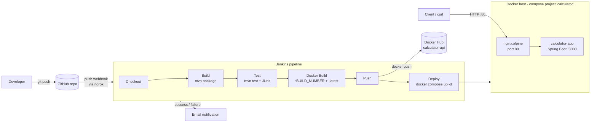

# Report notes

## Architecture

## Pipeline stages

**Checkout.** `checkout scm` pulls the exact commit that triggered the build from GitHub
(the job is configured as *Pipeline script from SCM*, so the `Jenkinsfile` itself is
versioned with the code). The commit is printed to the log for traceability.

**Build.** `mvn clean package -DskipTests` compiles the code and packages the Spring Boot
fat JAR. Tests are skipped here so a compilation problem fails fast and is reported
separately from a test failure.

**Test.** `mvn test` runs the JUnit 5 unit tests (`CalculatorServiceTest`) and the MockMvc
integration tests (`CalculatorControllerTest`, which boots the full Spring context and
checks every endpoint, the error responses and `/actuator/health`). Surefire's XML reports
are published with the `junit` step in a `post { always }` block, so results show up in
Jenkins even when tests fail; any failure makes Maven exit non-zero and stops the pipeline.

**Docker Build.** Builds the multi-stage `Dockerfile`: a Maven stage (dependencies cached
in their own layer via `dependency:go-offline`) produces the JAR, and only that JAR is
copied into a slim `eclipse-temurin:21-jre-alpine` image running as a non-root user with a
built-in healthcheck. The image is tagged with both the Jenkins build number (immutable,
traceable) and `latest`.

**Push.** Logs in to Docker Hub with the `dockerhub-creds` Jenkins credential via
`withCredentials` (the token is never in the repo or interpolated by Groovy, and Jenkins
masks it in logs), pushes both tags, and always logs out afterwards.

**Deploy.** Runs `docker compose up -d --no-build --remove-orphans` with
`IMAGE_TAG=<build number>`. The fixed project name (`calculator`), absence of
`container_name` and `--remove-orphans` make the stage idempotent: a re-run just replaces
the app container with the new image. Nginx re-resolves the app through Docker DNS, so the
proxy keeps working across redeploys. The stage then polls `/actuator/health` *through
nginx* up to 30 times and fails the build if the app never reports `UP`.

**Notifications.** A `post { success / failure }` block emails the job name, build number
and build URL (failure mails attach the console log) using the Email Extension plugin.

## Challenges and fixes

> Fill in exact error messages / screenshots where you have them.

1. **Java shim crash** — the `java` launcher on `PATH` (a shim/redirect rather than the
   real JDK binary) crashed or resolved to the wrong Java. Fixed by pointing `JAVA_HOME`
   at the JDK 21 install and putting `%JAVA_HOME%\bin` first in `PATH`.
2. **PATH / Maven** — `mvn` was not recognised until Maven was extracted to
   `C:\Tools\apache-maven-3.9.16` and its `bin` folder added to `PATH` (new terminal
   required). The project also ships the Maven wrapper (`mvnw`) as a fallback.
3. **VS Code extension** — the Java/Spring extensions in VS Code interfered with the
   setup (wrong JDK picked / project not importing); resolved by configuring the JDK path
   for the extension and reloading the window.
4. **Port 8080 clash** — Jenkins already listens on 8080, so the app runs locally on
   8089 (`server.port`), the container listens on 8080 internally (`SERVER_PORT`), only
   nginx is published (port 80), and Jenkins-in-Docker is published on 9090.
5. **Docker-outside-of-Docker bind mounts** — when Jenkins runs in a container using the
   host's Docker socket, Compose bind-mount paths (`./nginx/nginx.conf`) are resolved by
   the host daemon. Solved by mounting `jenkins_home` at the same path on host and
   container.
6. **Stale upstream after redeploy** — nginx resolves `proxy_pass` hostnames once at
   start-up, so a recreated app container (new IP) would cause 502s. Fixed with
   `resolver 127.0.0.11` and a variable `proxy_pass` so the name is re-resolved.
7. **nginx healthcheck stuck in "starting"** — `wget http://localhost` inside the Alpine
   container tried IPv6 `::1` first while nginx listens on IPv4 only; using `127.0.0.1`
   fixed it.
8. **Transient Maven download failure in `docker build`** — the first build failed in
   `dependency:go-offline` on a plugin download; a rebuild succeeded. Dependency layer
   caching means later builds don't re-download.
